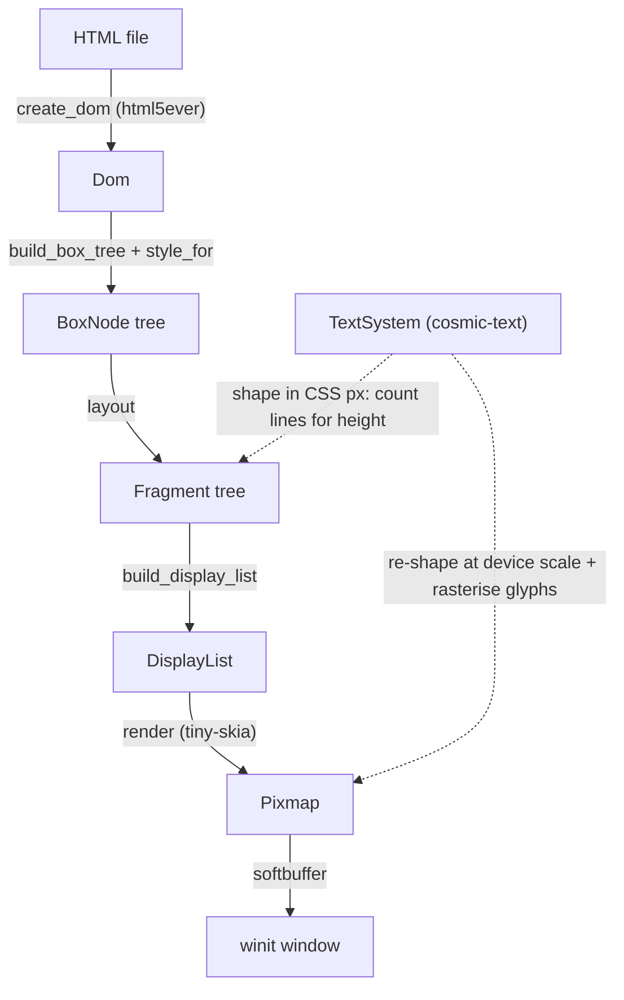

# Rock

Rock is a browser _engine_. Not a wrapper for chromium, gecko or the likes but its own browser engine.

It is not meant to be production ready and will likely not be able to render and display google.com correctly for a
long long while if at all, but it is supposed to be a long term project to show my own skills.

## Rendering flow



The DOM is parsed once at startup; every redraw (resize, scale change) and this
is just because I don't want to work out caching yet. The TextSystem is used
twice (for measurements and then rasterisation at render time).


## Snapshots & testing
Be sure to use `--workspace`:

```sh
cargo test --workspace
```

A handful of tests are `insta` powered snapshots, you will need `cargo-insta`:

```sh
cargo install cargo-insta
```
